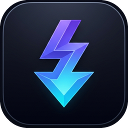

<p align="center">
  
</p>

<h1 align="center">Fetchly</h1>

<p align="center">
  <b>Fast, all-in-one download manager &amp; multi-site torrent search.</b><br>
  Built in Rust &amp; React (Tauri 2) for Windows, macOS and Linux.
</p>

<p align="center">
  <a href="https://github.com/karthik-cracking/fetchly/releases/latest"></a>
  <a href="LICENSE"></a>
  
</p>

---

**Fetchly** splits every download into up to **32 parallel connections**, searches torrents across multiple indexers in one place, captures browser downloads and streaming videos, and survives crashes, sleep, and network drops.

Free, open source, no ads, no accounts, no telemetry.

## ✨ Features

| | |
|---|---|
| 🔍 **Built-in Torrent Search** | Search across **1337x**, **The Pirate Bay**, **YTS**, **Nyaa**, and **EZTV** in parallel, or **add your own custom torrent sites**. Filter results instantly by **quality** (4K/2160p, 1080p, 720p, 480p), **audio/language/dub** (Dual Audio, Multi, Hindi, English, Japanese, Subs, etc.), **video format/codec** (x265/HEVC, x264, AV1, BluRay, WEB-DL, HDR, 10-bit), **minimum seeders**, and **keyword**, then click once to open the torrent file picker. |
| ⚡ **Up to 15× Faster** | Multi-connection Rust download engine with dynamic work-stealing segmentation and automatic per-server connection limit detection. |
| 🔁 **Crash-Safe Resume** | Pause, close your laptop, or lose power — Fetchly resumes from its checkpoint and validates against the server. |
| 🧲 **Full BitTorrent Support** | Magnet links and `.torrent` files with selective file picking, seeding/speed limits, and built-in search. |
| 🌐 **Browser Integration** | Works with Chrome, Edge, Brave, Opera, Vivaldi, and Firefox via native messaging. |
| 🎬 **Video & Audio** | Download from YouTube and 1,800+ sites via `yt-dlp`: MP4 up to 8K/HDR, MP3 audio, subtitles, chapters, and SponsorBlock. |
| 🤖 **AI Models (Hugging Face)** | Search and download models from Hugging Face with automatic file selection and SHA-256 verification. |
| 🗂 **Organized** | Categories, scheduled queues, speed limiter, site grabber, batch downloads, clipboard monitor, and built-in media tools (Convert / Make smaller). |
| 🎨 **Liquid-Glass UI** | Dark &amp; light themes, accent colors, compact mode, mini window, and drop zone. |

## 🛠 Building from Source

### Prerequisites
- [Rust](https://rustup.rs/) (stable)
- [Node.js](https://nodejs.org/) 20+

### Build &amp; Run

```bash
# 1. Build the browser extension assets
cd extension
npm install
npm run build

# 2. Build the frontend + sidecar and launch Fetchly
cd ../app
npm install
npm run tauri:dev
```

To build a release installer:

```bash
cd app
npm run tauri:build
```

## 📄 License &amp; Attribution

Fetchly is licensed under the **[MIT License](LICENSE)**.

Fetchly is based on **[Prism Download Manager](https://github.com/FortoGraphy/prism-download-manager)** (`Copyright (c) 2026 Jan Sechovec and Prism contributors`), extended with built-in multi-site torrent search, advanced audio/language/format filtering, custom site management, and ongoing enhancements.
